## 一、灵感点

  

    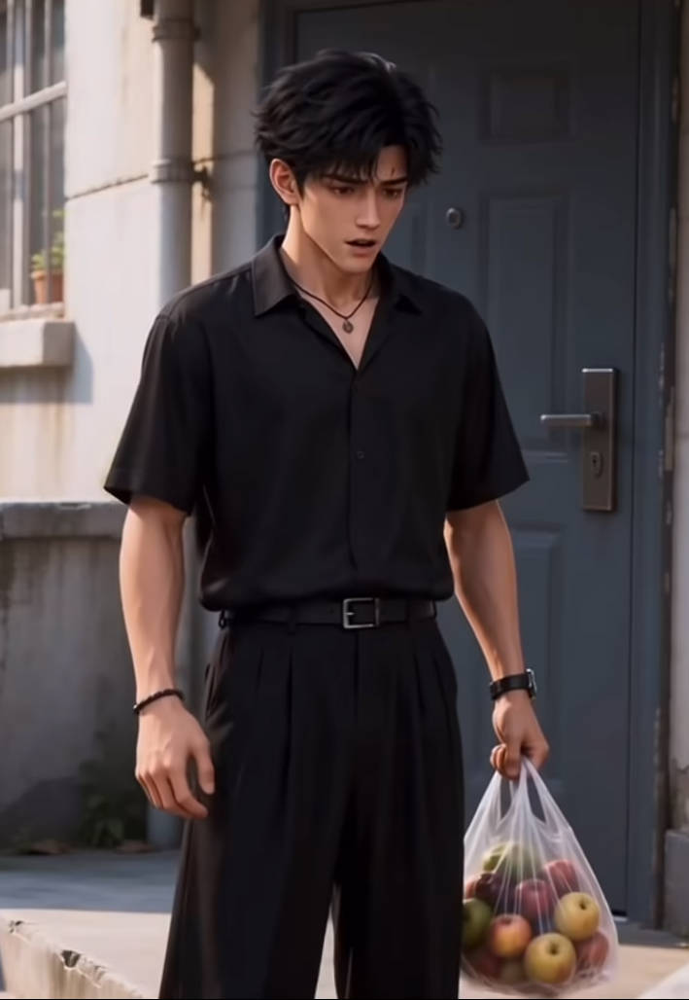
  

  

    <h3 style="margin-top: 0; margin-bottom: 12px;">简约轻熟风</h3>
    <ul>
      <li><strong>上衣</strong>：纯黑色长袖（或半袖）衬衫，偏宽松版型，面料有垂坠感，领口自然敞开，利落清爽</li>
      <li><strong>下装</strong>：黑色高腰西裤，高腰版型拉长腿部比例，整体配色统一</li>
      <li><strong>配饰</strong>：深色串珠手链（如黑曜石或檀木），为现代感穿搭增添沉稳的中式文玩感</li>
      <li><strong>整体氛围</strong>：偏韩系简约、轻熟都市风，All Black 配色沉稳成熟，适合相亲、正式社交等场合</li>
    </ul>
  

  

    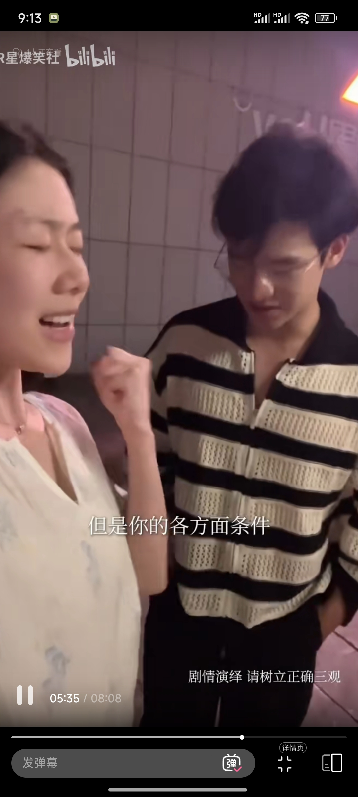
  

  

    <h3 style="margin-top: 0; margin-bottom: 12px;">韩系休闲风</h3>
    <ul>
      <li><strong>上衣</strong>：黑白粗条纹镂空针织衫，微宽松慵懒，双拉链（上下V字）设计拉长身高比例</li>
      <li><strong>下装</strong>：垂感黑色长裤，整体控制在黑白灰色系内</li>
      <li><strong>配饰</strong>：深色串珠手链</li>
      <li><strong>整体氛围</strong>：偏韩系休闲、文艺暖男路线，整体柔和、亲和力强，适合日常约会、聚会等轻松场合</li>
    </ul>
  

#### 总结

简单来说两套风格都属于韩系穿搭，只不过方向不同，一套是韩系轻熟风，一套是韩系休闲风。

**版型 + 面料**是最重要的：
1. 版型：上衣要买正肩或者微阔、偏宽松的，裤装要买直筒
2. 面料：质感决定了衣服的好坏，千万不要选容易皱、起球的劣质面料

另外的一些技巧：
1. 叠穿：搭配出层次感
2. 干净：整个人一定要散发出干净、整洁的印象，头发一定要有纹理或者抓出蓬松感
3. 露：一身黑穿搭往往也会有些沉闷，而适度的 “露”，比如衬衫解开 2~3 颗扣子，挽起袖口漏出小臂，这叫“呼吸感”，打破沉闷

## 二、韩系穿搭

首先，韩系穿搭并不只是指上装、下装穿好就行了，它指的是一个人的**整体氛围**，包括了发型、皮肤、脸、身材、上装、下装、比例、配饰、鞋子等，一起搭配出一种简约干净的感觉。

本篇文章只讨论穿搭，其他方面请查看：[美商提升](/13.热爱清单/03.美商提升.md)

首先说明一点，韩系穿搭的核心是偏瘦高的身材，如果没有这种身材，上身效果会比较的不理想。

### 风格方向

#### 1 经典简约风

这是韩系最核心的流派，上装以白T、白色衬衫、素面针织为主，下装以直筒牛仔裤、直筒西裤为主，干净利落。

  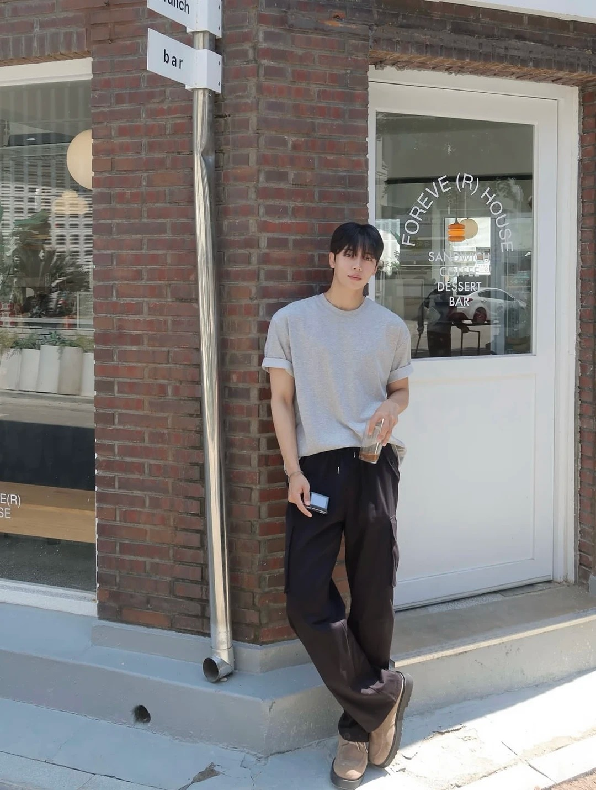
  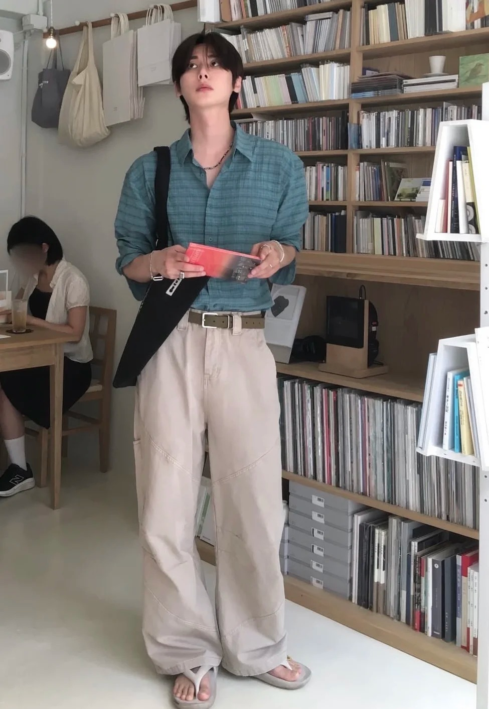
  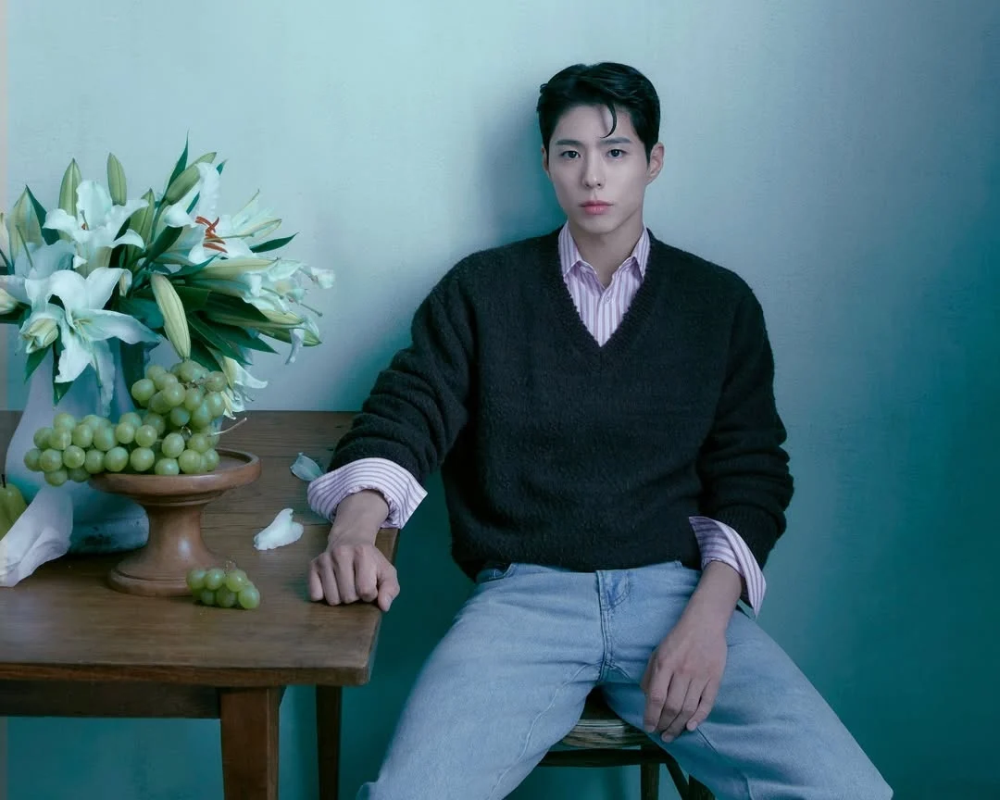

#### 2 复古学院风

利用浅色衬衫、针织背心、燕麦色开衫等单品进行叠穿，能自然地增加上半身的层次和体积感。这类风格自带温和气质与书卷气，也被称为高智风。

  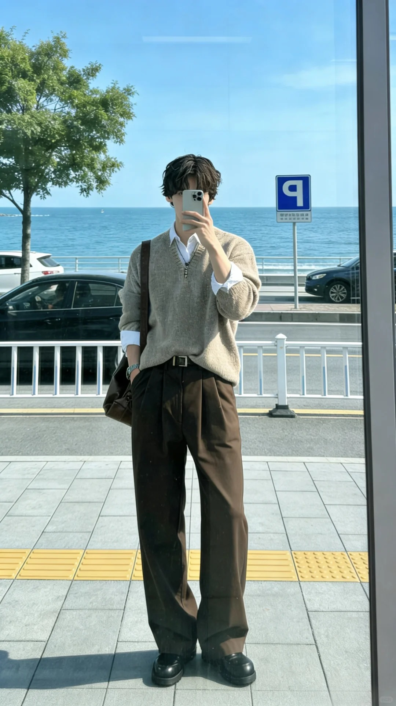
  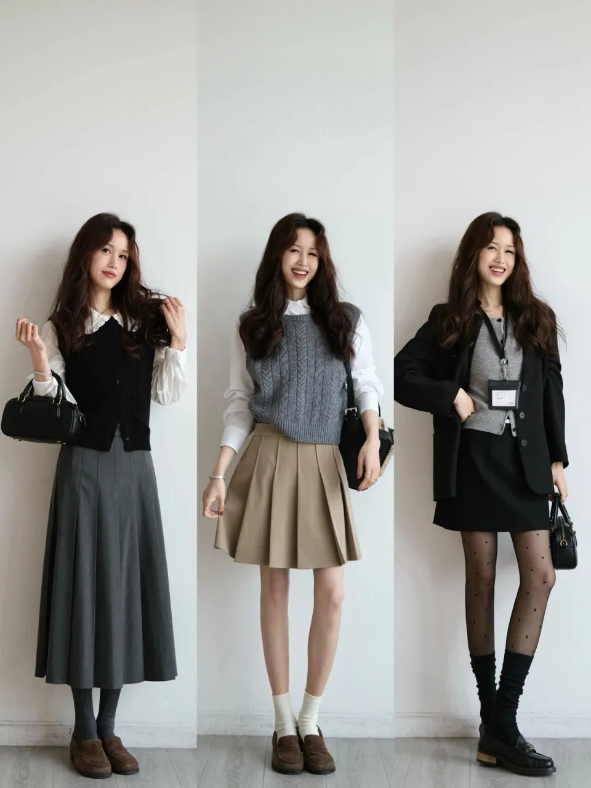

是不是感觉有点公式化？来，直接上一套韩国校服，衬衫 + 针织马甲 + 类西服外套：

  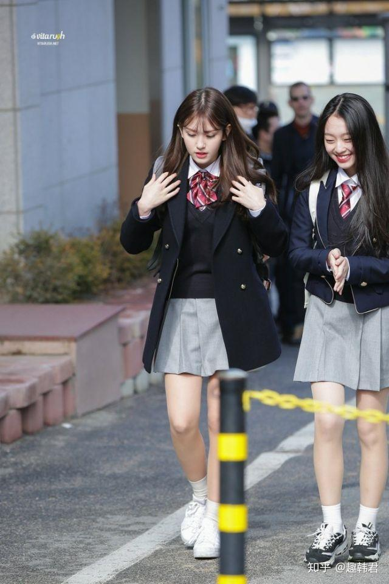
  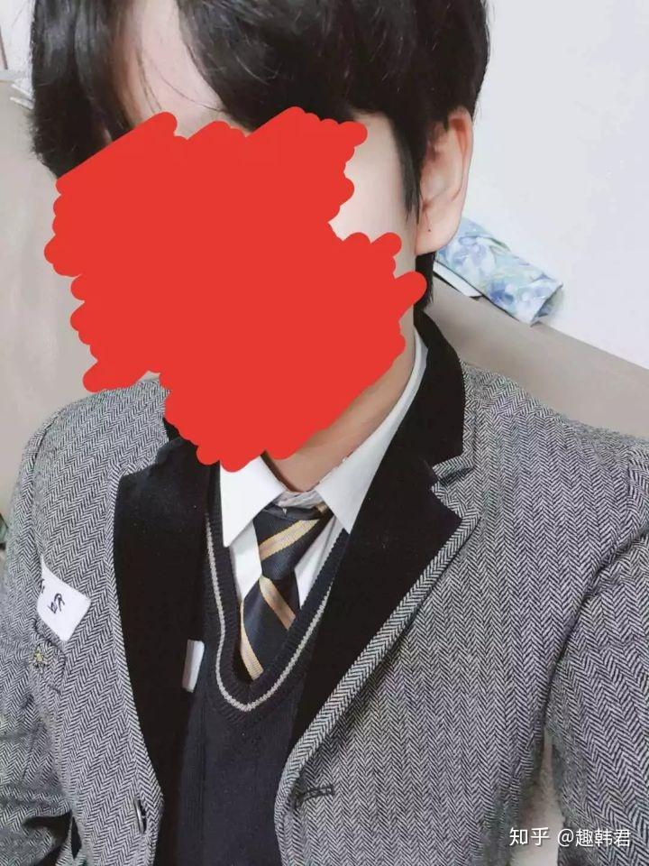

对比之后是不是就很明显了，学院风就是根据校服的风格改装而来的，就显得比较高智，再加上复古的暖色调，两相结合就显得很有股温和的气质。

#### 3 精致松弛风

一种较为高级的玩法，核心公式是 “内紧外松” 的薄厚叠穿：内层用贴身的薄打底，中层用挺括的衬衫（解开上两颗扣子制造V领线条），外层再套上廓形感的夹克或针织背心。这种穿法能制造丰富的纵向和横向线条，既保留了瘦削的骨感，又通过外层的“松”来增加体量，非常有层次感。

### 关键点

> **上宽下直露腰线、上紧下松、上浅下深**
>
> 另外：能去线下试穿的话，就去线下试穿

1. **颜色**：无 logo 或小 logo，低饱和度为主
2. **面料**：中层和外层，尽量选择挺括的，能撑得起衣服结构的面料
3. **版型**：正肩或者微廓、偏宽松版型，肩线要落在肩峰或其下最多3~4厘米处
4. **长期单品**：追求长期耐穿，质量保证的单品
5. **叠穿**：标准的三层法则：贴身薄打底 + 质感挺括的中层（如牛津纺衬衫、薄针织）+ 有结构的外层（如教练夹克、廓形衬衫）。材质上，优先选择挺括的棉质、密实针织、牛仔或有垂坠感的西装面料，避开过于软塌贴身的料子

### 单品入手建议

> [!IMPORTANT] 学习思维
> 诚然，找一个跟自己身材相似的穿搭博主，直接模仿对方的穿搭是能让自己上身效果最好的一种最有效率的方式，但是我们的目标并不是要学习别人的穿搭，而是要根据别人的穿搭**建立起一套属于自己的穿搭体系**。所以我更建议的是在不同温度下，以一件单品为起点，开始搭配出适合自己和这件单品的其他服装，继续再以这件单品关联的其他服装为起点，再次进行搭配，以此类推。
> 
> 在你自己思考如何搭配这件单品完成一套穿搭时，你学到的其中的搭配逻辑，才是真正的学问，并且这是一个需要时间积累的过程。
>
> 最后，在你的穿搭体系形成一定框架的时候，当你看到一套穿搭，你会自然的分析出其风格、版型、比例、叠穿、配饰等元素，然后你就可以用已有的类似的单品直接复刻，你会发现，偶买嘎，不同的衣服，却搭配出了同样的感觉，甚至在某些细节处，还可以发挥点自己的小巧思呢。--> [模仿穿搭才是我们过度购物的原因](https://www.bilibili.com/video/BV1DUxq6sEHh)

1. 一件肩线精准的**挺括衬衫**（牛津纺或棉质，白色/浅蓝）：单穿或作为叠穿中层，它是塑造肩部轮廓的基石。
2. 一件微落肩的**密织针织开衫**（燕麦色、炭灰色）：作为外层，自然增加肩部量感，温柔且百搭。
3. 一件**短款廓形夹克**（如哑光质感的面料）：搜索时可以留意“短宽廓形”这个关键词，它被很多窄肩男生验证过能有效“视觉上秒变直角宽肩”。
4. 一条垂感良好的**直筒/微锥西裤或牛仔裤**：平衡上半身的层次，用利落的裤型拉长下半身线条，避免上下都松垮。
5. 一件质感好的**纯色贴身打底T恤/高领**：作为“内紧外松”公式里的内层，它的使命是轻薄贴身，不增加臃肿感。

## 三、参考解析

  

    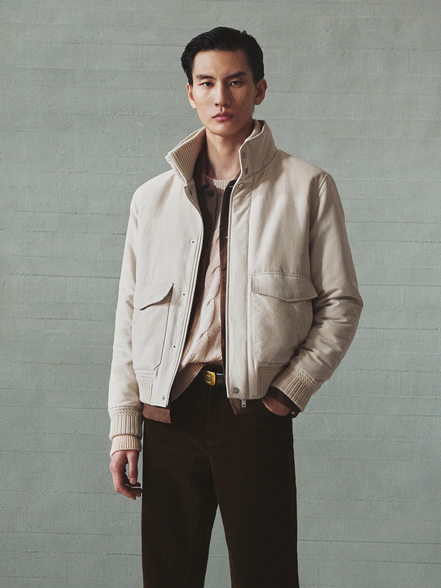
  

  

    <ul>
      <li><strong>上衣</strong>：
         <a href="https://ur.cn/product-detail/4909382783792812050" target="_blank" rel="noopener noreferrer">圆领针织</a>
         、
         <a href="https://ur.cn/product-detail/4913189444088296457" target="_blank" rel="noopener noreferrer">开襟衬衫</a>
         、
         <a href="https://ur.cn/product-detail/4912564911481347171" target="_blank" rel="noopener noreferrer">棉服</a>
      </li>
      <li><strong>腰带</strong>：古铜色</li>
      <li><strong>下装</strong>：黑色直筒休闲裤</li>
    </ul>
  

  

    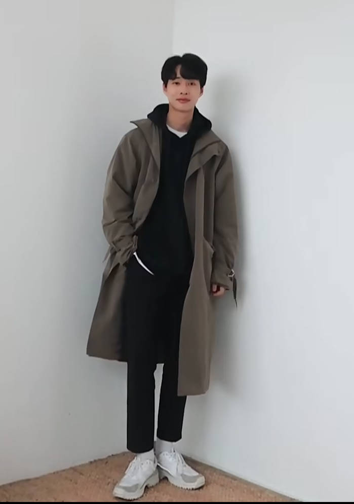
  

  

    <ul>
      <li><strong>上衣</strong>：
         白色圆领T恤、黑色连帽卫衣、咖绿风衣
      </li>
      <li><strong>下装</strong>：黑色直筒九分裤</li>
      <li><strong>鞋子</strong>：白袜+白色休闲鞋/白色老爹鞋</li>
    </ul>
    
有一个亮点：“呼吸感”，在脖子处和衣服下摆处，漏出了白色T恤，显得整体不那么沉闷（一身黑很容易显得沉闷）

  

